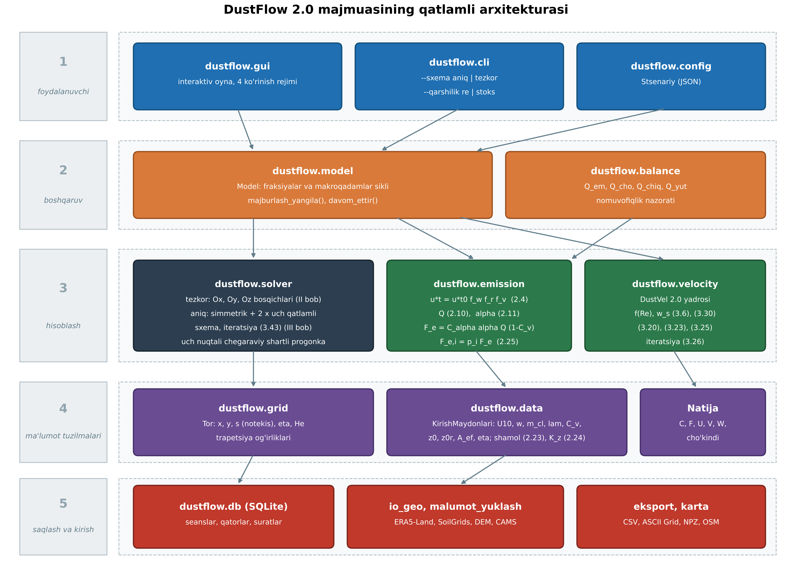
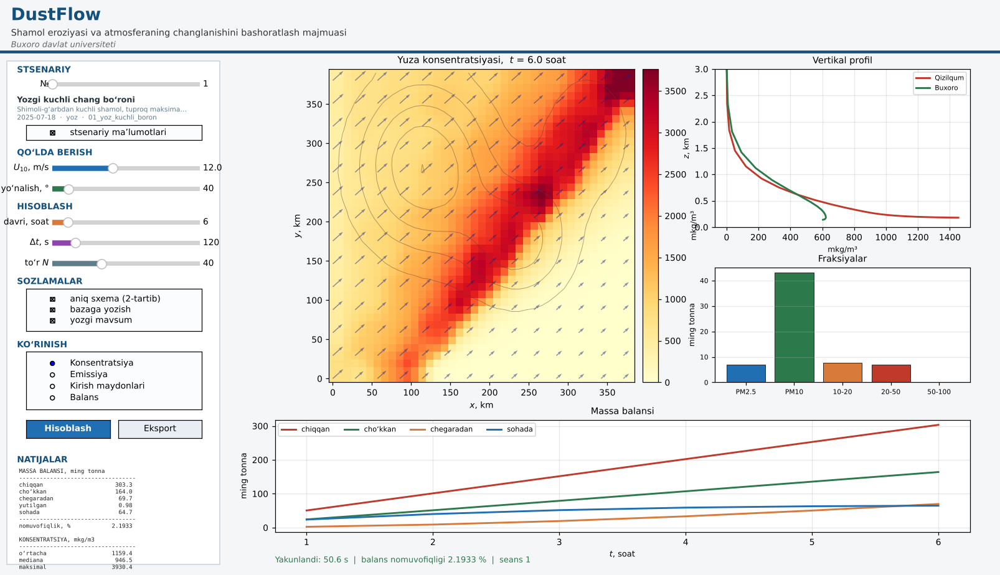

# DustFlow

Shamol eroziyasi va atmosferaning changlanishini monitoring qilish va bashoratlash uchun dasturiy majmua.

[](https://www.python.org/)
[](LICENSE)
[](https://doi.org/10.5281/zenodo.24374626)

## Tavsif

DustFlow shamol eroziyasi natijasida yer sirtidan atmosferaga ko'tarilgan chang zarrachalarining ko'chishi va diffuziyasini uch o'lchovli nostatsionar model asosida hisoblaydi. Majmua emissiya sxemasidan tortib natijalarni vizuallashtirishgacha bo'lgan butun jarayonni qamrab oladi.

Majmua Buxoro davlat universitetida bajarilgan dissertatsiya ishi doirasida yaratilgan. Hisoblash yadrosi dissertatsiyaning II va III boblariga mos keladi.

### 2.0 versiyadagi o'zgarishlar

| Qism | 1.x | 2.0 |
|---|---|---|
| Emissiya | Shao–Lu, Fécan, Raupach, White | (2.1)–(2.12): `u*t = u*t0(d_s) f_w f_r f_v`, `F_e = C_alpha * alpha * Q * (1 - C_v)`, `alpha = 100 * 10^(0.134 %clay - 6)`, `C_alpha = 1e-2` |
| Fraksiyalar | 5 ta | 5 ta, `F_e,i = p_i F_e`, p = 0,049; 0,327; 0,088; 0,327; 0,208 (2.25) |
| Shamol, diffuziya | darajali profil, Monin–Obuxov | logarifmik profil (2.23), `K_z = kappa u* (min(z, h_s) + h_0)` (2.24) |
| Cho'kish tezligi | Stoks | `w_s f(Re(w_s)) = g tau`, `f(Re) = 1 + 0.15 Re^0.687` (3.6); `w_d = w_s + w_dt` (2.22) |
| Zarracha tezliklari | Stoks, CN + BDF2 | DustVel 2.0 yadrosi: (3.20), (3.23), (3.25) va iteratsiya (3.26) |
| Chegaraviy shartlar | konservativ chekli hajm | (2.16)–(2.21), (3.8): uch nuqtali formulalar, progonka koeffitsiyentlari alpha_0, beta_0 va th_N |
| Sonli sxema | CN + van Leer, 1 rejim | ikki rejim: `tezkor` (II bob) va `aniq` (III bob) |
| Vertikal to'r | tekis, L = 20 | yer sirti yaqinida quyuqlashgan, L = 30 (birinchi qatlam ≈ 0,5 m) |

## Arxitektura



| Qatlam | Modullar | Vazifasi |
|---|---|---|
| 1. Foydalanuvchi | `gui`, `cli`, `config` | interaktiv oyna, buyruqlar qatori, stsenariy JSON |
| 2. Boshqaruv | `model`, `balance` | hisoblash sikli, massa balansi |
| 3. Hisoblash | `solver`, `emission`, `velocity` | matematik yadro |
| 4. Ma'lumot tuzilmalari | `grid`, `data` | `Tor`, `KirishMaydonlari` |
| 5. Saqlash | `db`, `eksport`, `io_geo`, `karta`, `logging` | SQLite, NetCDF/GeoTIFF, CSV/ASCII Grid, OSM kartalar |

## Matematik model

Har bir fraksiya `i = 1..5` uchun relyefga moslashgan koordinatalarda `s = (z - eta)/He`, `He = Hz - eta` (3.9)–(3.12):

```
dth/dt + v_x dth/dx + v_y dth/dy + omega dth/ds
    = (1/He) d/dx(He K_x dth/dx) + (1/He) d/dy(He K_y dth/dy) + (1/He^2) d/ds(K_z dth/ds) - sigma th + f

-K_x dth/dx |x=0  = xi (th_E - th),       K_x dth/dx |x=Lx = xi (th_E - th)      (y bo'yicha ham)
-K_z dth/dz |z=eta = F_e,i - w_d,i th,    K_z dth/dz |z=Hz = xi_z (th_E - th)
```

## Sonli sxema

Fazoviy operator yuqori oqim (upwind) yaqinlashuvida yoziladi, (3.37):

```
Lambda th_i = A_i th_{i-1} - (A_i + C_i) th_i + C_i th_{i+1},
A_i = K_{i-1/2}/h^2 + v_i^+/h,   C_i = K_{i+1/2}/h^2 - v_i^-/h
```

Uch diagonalli sistemalar progonka usuli bilan yechiladi. Chegaraviy shartlar uch nuqtali bir tomonlama formulalar orqali progonka koeffitsiyentlariga kiritiladi:

```
alpha_0 = K(4c_1 - b_1) / (3Kc_1 - Ka_1 + 2h xi c_1),
beta_0  = (K d_1 + 2h c_1 g) / (3Kc_1 - Ka_1 + 2h xi c_1),
th_N    = (2h g + K(4beta_{N-1} - beta_{N-2} - alpha_{N-2} beta_{N-1}))
          / (3K + 2h xi + K alpha_{N-2} alpha_{N-1} - 4K alpha_{N-1}).
```

Vertikal to'r notekis bo'lgani uchun dastur bu formulalarning notekis qadamli umumlashmasidan foydalanadi. Tekis to'rda u yuqoridagi formulalarga aynan teng bo'ladi (`tests/test_yechuvchi.py` da tekshiriladi).

**`--sxema tezkor`** — II bob, § 2.3. Fazoviy yo'nalishlar bo'yicha ajratish qo'llaniladi: `n → Ox → Oy → Oz → n+1`. Har bir bosqich to'liq `dtau` qadam bilan, oshkormas sxemada bajariladi; `sigma` va `f` bosqichlar orasida teng taqsimlanadi. Vaqt bo'yicha aniqlik birinchi tartibli.

**`--sxema aniq`** (standart) — III bob, § 3.3. Makroqadam uchta kichik qadamga bo'linadi:

| Bosqich | Sxema | `gamma` | Tenglama |
|---|---|---|---|
| `n → n+1/3` | simmetrik oshkormas sxema (Krank–Nikolson) | `dtau/6` | `th - gamma Lambda th = th^n + gamma Lambda th^n + 2 gamma f` |
| `n+1/3 → n+2/3` | ikkinchi tartibli uch qatlamli oshkormas sxema (BDF2) | `2dtau/9` | `th - gamma Lambda th = (4th^k - th^{k-1})/3 + gamma f` |
| `n+2/3 → n+1` | ikkinchi tartibli uch qatlamli oshkormas sxema (BDF2) | `2dtau/9` | ↑ |

Har bir kichik qadamdagi uch o'lchovli tenglama fazoviy yo'nalishlar bo'yicha ajratishga asoslangan iteratsiya bilan yechiladi, (3.43):

```
th^(m+1/3) - gamma Lam1 th^(m+1/3)            = F + gamma (Lam2 + Lam3 - sigma) th^(m)
th^(m+2/3) - gamma Lam2 th^(m+2/3)            = th^(m+1/3) - gamma Lam2 th^(m)
th^(m+1)   - gamma (Lam3 - sigma) th^(m+1)    = th^(m+2/3) - gamma (Lam3 - sigma) th^(m)
```

Iteratsiya `max|th^(m+1) - th^(m)| <= eps max|th^(m+1)|`, `eps = 1e-6` shartda to'xtatiladi. Odatda kichik qadamda 2–3 marta takrorlanadi. Vaqt bo'yicha aniqlik ikkinchi tartibli.

Ikki rejimning farqi:

| | `tezkor` | `aniq` |
|---|---|---|
| Vaqt bo'yicha tartib | 1 | 2 |
| Bir makroqadamdagi progonkalar | 3 | ≈ 3 × 3 × (2–3) |
| Hisoblash vaqti (60×60×30, 6 soat, `dt = 120` s) | ≈ 50 s | ≈ 115 s |
| Qachon ishlatiladi | tezkor baholash, ko'p variantli hisob | asosiy hisoblar, katta vaqt qadami |

## Ma'lumotlar bazasi

SQLite bazasi beshta jadvaldan iborat: `seanslar`, `maydonlar`, `qatorlar`,
`suratlar`, `kuzatuvlar`. Baza quyidagilarni ta'minlaydi:

- sutkalik hisoblashlarni bir-biri bilan solishtirish;
- takroriy hisoblashlardan qochish (parametrlar bo'yicha SHA-256 barmoq izi);
- uzilgan hisoblashni oxirgi suratdan davom ettirish (`model.davom_ettir()`);
- kuzatuv ma'lumotlari bilan solishtirish uchun arxiv yuritish.

## O'rnatish

```bash
git clone https://github.com/ShafiyevT/DustFlow.git
cd DustFlow
pip install -r requirements.txt
pip install scipy netCDF4 rasterio      # stsenariylar (NetCDF/GeoTIFF) uchun
```

## Stsenariylar

Majmua NetCDF va GeoTIFF formatidagi geofazoviy ma'lumotlar bilan ishlaydi.
Buxoro viloyati uchun 10 ta namunaviy stsenariy tayyorlangan.

### Stsenariylarni yaratish

```bash
python -m dustflow --stsenariy-yarat
```

Har bir stsenariy uchun alohida katalogda quyidagi fayllar yaratiladi:

| Fayl | Format | Aniqlik | Mazmuni | Manba |
|---|---|---|---|---|
| `meteo.nc` | NetCDF | 0,25° | `u10`, `v10`, `t2m`, `swvl1` | ERA5 / ERA5-Land |
| `relyef.tif` | GeoTIFF | 0,01° | balandlik | SRTM |
| `qoplam.tif` | GeoTIFF | 0,05° | o'simlik qoplami | MODIS LAI |
| `tuproq.tif` | GeoTIFF | 0,05° | gil ulushi | SoilGrids |
| `z0.tif`, `A_ef.tif` | GeoTIFF | 0,05° | g'adir-budurlik, eroziyaga beriluvchan yuza | MODIS Land Cover |
| `manbalar.json` | JSON | — | maydonlar tavsifi va manbalari | — |

### Ro'yxatni ko'rish

```bash
python -m dustflow --royxat
```

| № | Identifikator | Nomi | Sana | Mavsum |
|---|---|---|---|---|
| 1 | `01_yoz_kuchli_boron` | Yozgi kuchli chang bo'roni | 2025-07-18 | yoz |
| 2 | `02_yoz_ortacha` | Yozgi o'rtacha shamol | 2025-07-05 | yoz |
| 3 | `03_bahor_boron` | Bahorgi chang bo'roni | 2025-04-12 | bahor |
| 4 | `04_kuz_quruq` | Kuzgi quruq davr | 2025-10-08 | kuz |
| 5 | `05_qish_nam` | Qishki nam sharoit | 2026-01-22 | qish |
| 6 | `06_afgon_shamoli` | «Afg'on» shamoli | 2025-06-14 | yoz |
| 7 | `07_sokin_kun` | Sokin kun (nazorat varianti) | 2025-05-20 | bahor |
| 8 | `08_sugorish_mavsumi` | Sug'orish mavsumi | 2025-06-28 | yoz |
| 9 | `09_qurgoqchilik` | Qurg'oqchilik yili | 2025-08-11 | yoz |
| 10 | `10_ekstremal` | Ekstremal chang bo'roni | 2025-07-29 | yoz |

### Stsenariyni tanlash

Uch usul mavjud.

**1. Buyruqlar qatorida — raqami yoki identifikatori bo'yicha:**

```bash
python -m dustflow --stsenariy 6
python -m dustflow --stsenariy 06_afgon_shamoli
python -m dustflow --stsenariy afgon           # nomi bo'yicha qisman moslik
```

Qo'shimcha parametrlar: `-T 12` (davri, soat), `--dt 120`, `-N 60`, `-L 30` (to'r),
`--sxema aniq|tezkor`, `--qarshilik re|stoks`, `--beta-s 8`, `--C-alpha 1e-2`,
`--eksport natijalar` (GIS formatlariga eksport).

**2. Grafik interfeysda — «STSENARIY» surgichi orqali:**

```bash
python -m dustflow --gui
```

Surgichni 1 dan 10 gacha suring; tanlangan stsenariyning nomi, tavsifi va sanasi
darhol ko'rinadi. «stsenariy ma'lumotlari» katagi belgilangan bo'lsa, hisoblash
NetCDF/GeoTIFF fayllaridan olinadi; belgi olib tashlansa, «QO'LDA BERISH»
bo'limidagi surgichlar ishlaydi.

**3. Dasturda:**

```python
from dustflow.io_geo import stsenariylar_royxati, stsenariy_yukla

r = stsenariylar_royxati("stsenariylar")
k, tavsif = stsenariy_yukla(r[5]["yol"], t)      # 6-stsenariy
```

### Natijalarni solishtirish

Har bir hisoblash bazaga yoziladi va seans raqami beriladi:

```bash
python -m dustflow --solishtir 1 2 6 10
```

## Foydalanish

### Grafik interfeys

```bash
python -m dustflow --gui
```

«SOZLAMALAR» bo'limidagi «aniq sxema (2-tartib)» katagi olib tashlansa, `tezkor` rejim ishlatiladi.



### Kutubxona sifatida

```python
from dustflow.grid import Tor, relyef_yarat
from dustflow.data import buxoro_maydonlari
from dustflow.model import Model

t = Tor(Lx=380e3, Ly=390e3, Hz=5000.0, N=60, M=60, L=30, beta_s=8.0)
t.eta = relyef_yarat(t); t.He = t.Hz - t.eta

k = buxoro_maydonlari(t, U10_qiymat=12.0, yonalish=40.0)
m = Model(t, k, sxema="aniq", qarshilik="re", C_alpha=1e-2)
m.ishga_tushir(T=12*3600, dt=120.0)

print(m.massa_balansi())
print(m.v_t)                        # muvozanat cho'kish tezliklari w_s, m/s
yuza = m.yuza_konsentratsiya()      # kg/m3
```

Asosiy parametrlar: `sxema` (`"aniq"` | `"tezkor"`), `qarshilik` (`"re"` | `"stoks"`), `C_alpha`, `K_h` (gorizontal diffuziya, m²/s), `h_s`, `h_0` (2.24), `w_dt` (2.22), `xi` (yon chegaralar; `None` — o'rtacha shamol tezligi), `xi_z`, `sigma`, `eps`.

### Buyruqlar qatori

```bash
python -m dustflow --stsenariy 3 --sxema aniq -T 12 --dt 120
python -m dustflow --stsenariy 3 --sxema tezkor --qarshilik stoks     # II bobdagi chiziqli model
python -m dustflow --stsenariy 3 --C-alpha 5e-3 --eksport natijalar
```

### Baza bilan ishlash

```python
from dustflow.db import Baza
from dustflow.config import Stsenariy

st = Stsenariy(U10=12.0, T=12*3600)
b = Baza("dustflow.db")

mavjud = b.seans_bormi(st.kalit())      # takroriy hisoblashni tekshirish
sid = b.seans_ochish(st.nom, st.kalit())
m.ishga_tushir(T=st.T, dt=st.dt, baza=b, seans_id=sid, surat_qadam=30)

print(b.qatorlar(sid))                   # vaqt qatorlari
print(b.solishtirish([1, 2, 3]))         # seanslarni solishtirish
```

### Karta ustida chizish

Natijalarni haqiqiy karta asosida koʻrsatish uchun `karta` moduli ishlatiladi.
Karta asosi OpenStreetMap plitkalaridan olinadi:

```bash
pip install contextily
python examples/karta_misol.py
```

yoki dasturda:

```python
from dustflow.karta import karta_chiz

karta_chiz(t.x, t.y, C, lon0=64.4252, lat0=39.7682,
           manba_qutisi=(x0, y0, x1, y1), yonalish=40.0,
           asos="OSM",          # yoki "CARTO", "TOPO"
           yol="karta.png")
```

Internet mavjud boʻlmaganda modul sxematik asosga avtomatik oʻtadi va
xatolik bermaydi.

### Eksport

```python
from dustflow.eksport import csv_eksport, ascii_grid_eksport, npz_eksport, hisobot

y = m.yuza_konsentratsiya()
ascii_grid_eksport("natijalar/C.asc", t, y)   # QGIS / ArcGIS uchun
hisobot("natijalar/hisobot.txt", m, st)
```

## IV bob hisoblarini qayta bajarish

`ivbob_hisob/` papkasidagi skriptlar dissertatsiyaning IV bobidagi barcha hisob va rasmlarni qayta bajaradi. Bularga 2025-yil 28–30-aprel chang bo'roni, C_α ni kalibrlash, sezgirlik tahlili, stansiyalar va CAMS bilan taqqoslash hamda qurilish maydoni hisobi kiradi:

```bash
python ivbob_hisob/hammasi.py          # s01 … s08, taxminan 1,5 soat (2 yadro)
```

Kirish ma'lumotlari `haqiqiy_malumot/` papkasida bo'lishi kerak:

- `statik/*.tif`;
- `era5/era5land_2025-04-20_2025-05-01.nc`;
- `cams/cams_eac4_2025-03-01_2025-05-31.nc`;
- `stansiyalar/portal_soatlik.csv`.

Ular hajmi katta bo'lgani uchun repozitoriyga kiritilmagan. Ularni `malumot_yuklash.py` bilan yuklab olish mumkin (`YORIQNOMA_malumot.md` ga qarang). Natijalar `ivbob_natija/` ga yoziladi: `hisobot.txt`, `rasm_4_*.png`, `*.json`.

8-qadam (`s08_vakillik.py`) dissertatsiyaning 2-ilovasidagi tahlilni bajaradi. U har bir stansiya bo'yicha alohida statistikani hamda vakillik va vaqt siljishi tahlilini (stansiya atrofidagi 3×3 va 5×5 yacheyka, −6…+6 soat siljish) `vakillik.txt` va `vakillik.json` ga yozadi. Buning uchun 2-qadam stansiya atrofidagi 5×5 yacheykadagi qiymatlarni `boron_{variant}_qoshni.pkl` ga saqlaydi.

Shamol maydonining vertikal tashkil etuvchisi uzluksizlik tenglamasidan yer sirtidan yuqoriga integrallab topiladi. Yuqori chegara orqali havo oqimi cheklanmaydi. Bu advektiv shakldagi sxemada massa balansini saqlaydi: 2025-yil aprel bo'roni hisobida nomuvofiqlik 1 % dan kichik.

IV bob hisoblarida kalibrlangan `C_alpha = 0.75e-2` ishlatiladi (`ivbob_hisob/umumiy.py`, `C_ALPHA`). Dasturdagi standart qiymat II bobdagi boshlang'ich `1e-2` bo'lib qoladi. Model emissiyaga nisbatan chiziqli, shuning uchun boshqa `C_alpha` uchun natijalarni qayta hisoblamasdan ham masshtablash mumkin.

`KirishMaydonlari.z0_shamol` ixtiyoriy maydoni shamol profili va `K_z` uchun ishlatiladigan transport g'adir-budurligini emissiya uchun ishlatiladigan `z0` dan ajratadi. U lokal masalalarda kerak bo'ladi: masalan, shahar ichidagi qurilish maydonida emissiya yalang'och grunt bo'yicha (`z0 = 1e-3` m), havo oqimi esa shahar qurilmasi bo'yicha (`z0_shamol = 0.3` m) hisoblanadi. `None` bo'lsa, `z0` ishlatiladi.

## Testlar

```bash
python tests/test_yechuvchi.py
```

Testlar quyidagilarni tekshiradi:

- emissiya formulalari (2.3), (2.11), (2.25) va emissiyaning `C_alpha` ga chiziqli bog'liqligi;
- muvozanat cho'kish tezliklari (3.6) va Stoks qonunidan farq;
- zarracha tezliklari maydonining muvozanatga intilishi (L-turg'unlik);
- umumlashgan progonka formulalarining tekis to'rda `alpha_0`, `beta_0`, `th_N` formulalariga tengligi;
- statik holatning saqlanishi va yopiq sohada massaning saqlanishi;
- emissiya, cho'kish va oqib chiqish bo'yicha massa balansi;
- yutilishning analitik yechimga mosligi;
- `aniq` rejimda ikkinchi, `tezkor` rejimda birinchi tartibli yaqinlashish;
- `tezkor` rejimning monotonligi.

## Namunaviy natija

1-stsenariy, `60×60×30` to'r, `dt = 120` s, 6 soat:

| Kattalik | `tezkor` | `aniq` |
|---|---|---|
| Sirtdan chiqqan massa, ming t | 307,7 | 307,7 |
| Cho'kkan / chegaradan chiqqan / sohada, ming t | 166,8 / 72,7 / 70,7 | 166,8 / 72,6 / 70,4 |
| Yer sirtidagi konsentratsiya, o'rtacha / maks., µg/m³ | 1182 / 4105 | 1181 / 4140 |
| Massa balansi nomuvofiqligi | 0,3 % | 0,5 % |
| Hisoblash vaqti | 50 s | 115 s |

Massa balansi nomuvofiqligi tugunli to'rdagi advektiv shakldagi sxemaning konservativlik xatosini ko'rsatadi. U vertikal to'r maydalashtirilganda kamayadi (II bobdagi tekis to'rda 194 %, `L = 30`, `beta_s = 8` da 0,1–0,5 %). Yopiq sohadagi test masalalarida nomuvofiqlik 0,1 % dan oshmaydi.

## Cheklovlar

- Advektiv shakldagi tugunli sxema massani aynan saqlamaydi. Nomuvofiqlik `Model.massa_balansi()` orqali nazorat qilinadi.
- Uch nuqtali chegaraviy formulalar yer sirti yaqinidagi gradientlar yaxshi ajratilishini talab qiladi. Shuning uchun vertikal to'r quyuqlashtiriladi (`beta_s`, `L >= 30`).
- `simmetrik` bosqich monoton emas. Keskin uzilishli boshlang'ich holatda kichik manfiy qiymatlar paydo bo'lishi mumkin. Ular nolga tenglashtiriladi va qo'shilgan massa `kesilgan` sifatida hisobga olinadi.
- Metrik hadlar diffuzion operatorlarda soddalashtirilgan (kichik qiyalik).
- Nam yuvilish va koagulyatsiya hisobga olinmagan.
- Stsenariy ma'lumotlari namunaviy generator orqali yaratiladi. Haqiqiy ERA5/MODIS fayllari ham `io_geo` moduli orqali o'qiladi, ammo ularning o'zgaruvchi nomlari `manbalar.json` faylida ko'rsatilishi kerak.

## Bog'liq loyiha

[DustVel](https://github.com/ShafiyevT/DustVel) — zarrachalar harakat tezliklarini hisoblovchi alohida vosita. DustFlow 2.0 ning `velocity` moduli DustVel 2.0 yadrosining maydon ko'rinishidir.

## Litsenziya

MIT — [LICENSE](LICENSE) fayliga qarang.
